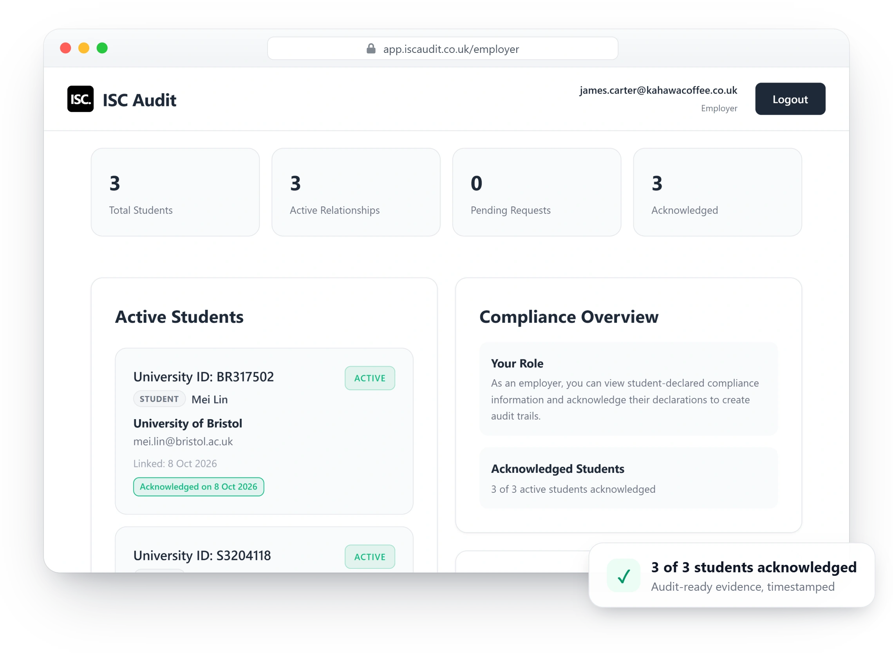

# ISC Audit – International Student Compliance Audit

[](https://github.com/hussainjaura/Hours-Tracker)


**Know each international student's weekly work limit, and keep a dated record of how you know it.**

International students on a UK Student visa can usually work up to 20 hours a week in term time (10 hours for courses below degree level) and full-time in the holidays. Term dates differ by university and course, so employers often guess, and the fines for illegal working now reach £60,000 per worker.

ISC Audit is a full-stack web app where students declare and confirm their term dates, and employers they work for can see the limit that applies today and acknowledge it. Every declaration and acknowledgement is saved in an audit log with the date, time and IP address, and both sides can download it as a PDF.

> **Live demo:** _add your deployed link here_
>
> | Role | Email | Password |
> | --- | --- | --- |
> | Student | `aisha.khan@demo.iscaudit.app` | `DemoPass@2026` |
> | Employer | `james.carter@demo.iscaudit.app` | `DemoPass@2026` |
>
> The two demo accounts are already linked, so you can see both sides straight away.



---

## How It Works

**For international students**
1. Sign up with your university, university ID, visa type and course end date
2. Add your term dates, by hand or from your university's term template
3. Confirm your term dates
4. Accept access requests from employers

**For employers**
1. Sign up with your organisation details
2. Request access to a student using their university ID
3. Once the student accepts, see their term dates and the weekly limit that applies today
4. Acknowledge the student's dates, and download a PDF audit pack

If a student later changes their term dates, the employer's acknowledgement is reset and they are asked to acknowledge the new dates.

---

## Features

- **Work limit rules:** term time vs holidays, 10 or 20 hours by course level, the Graduate Route visa (no weekly limit), the course end date, and a student's own lower limit
- **Safe defaults:** if term dates are missing, or the last declared term has ended before the course has, the term-time limit applies until the dates are added
- **Single source of truth:** the server works out the rule once, and the dashboards, audit trail and PDFs all display that same result
- **Student and employer dashboards:** separate, role-protected dashboards that work on desktop and phone
- **Access control:** an employer only sees a student's details, terms and audit trail after the student accepts their request, and never sees other employers' links
- **Audit log:** term declarations, confirmations, changes, deletions, access requests and acknowledgements, each with the date, time, IP address and browser. The app only adds entries and never edits or deletes them
- **PDF exports:** student audit pack, employer audit pack and a term dates letter, generated with PDFKit
- **Authentication:** JWT login, bcrypt password hashing, password strength rules, forgot and reset password by email, and optional email verification
- **Security:** rate limiting on login and sign-up, request size limits, a CORS allow-list, security headers, request IDs, input validation and central error handling

---

## Key Decisions

- **The server decides the rule, the browser only displays it.** Early on, the student dashboard, the employer dashboard and the server each worked out the weekly limit themselves, and they disagreed when the rules changed. Now `server/src/utils/workEligibility.js` is the only place the rule lives.
- **When the app doesn't know, it plays safe.** Missing or incomplete term dates mean the 20-hour term-time limit, never the full-time holiday rule.
- **Dates are compared as UK calendar days.** The last day of term still counts as term time, whatever time zone the user is in.
- **Acknowledgements expire when the facts change.** If a student edits their dates, the employer has to acknowledge again, so the audit trail never shows an acknowledgement of dates the employer never saw.
- **Demo data uses no hard-coded secrets.** The seed creates public demo accounts, and an admin account only if you set `SEED_ADMIN_EMAIL` and `SEED_ADMIN_PASSWORD` yourself.

---

## Tech Stack

| Area | Technologies |
| --- | --- |
| Frontend | React 18, Vite, React Router v6, Axios, Context API, CSS |
| Backend | Node.js, Express 5, ES Modules |
| Database | PostgreSQL, Prisma ORM, Prisma Migrations |
| Auth & Security | JWT, bcrypt, custom rate limiting and security middleware |
| Other | PDFKit (PDF generation), Resend (transactional email), dotenv, Nodemon |

---

## Project Structure

```
Hours-Tracker/
├── client/                 # React + Vite frontend
│   ├── public/
│   └── src/
│       ├── components/     # Layout, menu, protected routes, in-page notices
│       ├── contexts/       # Auth, mobile nav and notice context
│       ├── hooks/
│       ├── pages/          # Landing, auth pages, student and employer dashboards, 404
│       ├── services/       # Axios API client
│       └── utils/          # Date helpers
└── server/                 # Express API
    ├── prisma/             # Schema, migrations and seed script
    └── src/
        ├── middleware/     # Auth, roles, security, validation, errors
        ├── routes/         # Auth, students, employers, terms, relationships, audit...
        └── utils/          # Work eligibility, audit log and packs, PDFs, email
```

---

## Getting Started

### Prerequisites
- Node.js 18 or newer
- A PostgreSQL database (local, or a hosted one like Neon)

### 1. Clone the repo

```bash
git clone https://github.com/hussainjaura/Hours-Tracker.git
cd Hours-Tracker
```

### 2. Set up the server

```bash
cd server
npm install
cp .env.example .env
```

Fill in `DATABASE_URL` and `JWT_SECRET` in `server/.env`. The other settings are explained in the file.

Run the migrations, seed the database and start the API:

```bash
npx prisma migrate dev
npx prisma db seed
npm run dev
```

The seed adds two universities with this academic year's term templates, and the two demo accounts above. Run it again at any time to reset the demo accounts.

The API runs on http://localhost:4000. Without the Resend keys, emails (like password reset links) are printed in the server console instead.

### 3. Set up the client

In a new terminal:

```bash
cd client
npm install
cp .env.example .env
npm run dev
```

Open http://localhost:3000.

---

## Disclaimer

ISC Audit helps students and employers keep a clear record of term dates, work limits and acknowledgements. It is not legal advice, and it does not replace the Home Office right-to-work check.

---

## Author

**Muhammad Hussain Jaura**, Software Engineering student at Solent University, Southampton

[](mailto:hussainjaura10@gmail.com)
[](https://www.linkedin.com/in/muhammad-hussain-jaura-b303482b1/)
[](https://hussainjaura.github.io/Hussain-Portfolio/)
